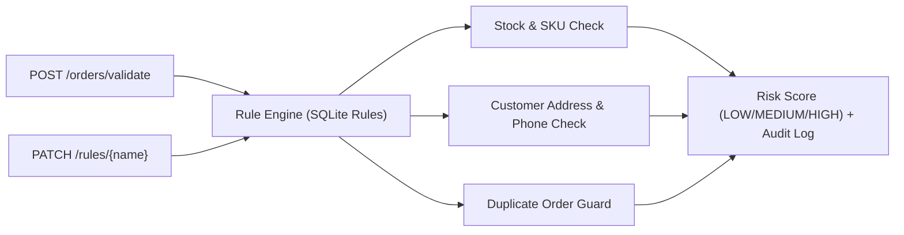

# Order Validation REST API (Python + SQLite)

A zero-dependency Python 3 REST API checkpoint service that validates incoming e-commerce/CRM orders against stock levels, customer profiles, and toggleable verification rules—persisting every decision in an auditable SQLite log.

## Architecture



## API Endpoints
- `GET /health` — Service health check
- `POST /orders/validate` — Validate order payload (`200 OK` if approved, `422` with structured issue codes if flagged)
- `GET /orders/{order_id}` — Fetch latest validation audit record for an order
- `GET /rules` — List all toggleable validation rules
- `PATCH /rules/{rule_name}` — Enable or disable a validation rule dynamically (`{"enabled": false}`)
- `GET /logs` — Retrieve recent validation audit entries

## Quick Start
Run the local validation demo:
```bash
python -m app.cli
```

Start the HTTP server locally:
```bash
python -m app.cli --serve --port 8080
```

Run end-to-end HTTP integration tests:
```bash
python -m unittest discover -s tests -v
```
