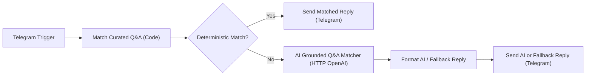

# n8n Telegram Q&A Chatbot Workflow

A single-file, importable **n8n** workflow (`workflow.json`) for a Telegram Q&A assistant combining fast deterministic keyword matching with a strictly grounded OpenAI fallback and a polite unmatched response.

## Architecture



## Key Features
- **Single-workflow design:** Import `workflow.json` directly into n8n (`Workflows > Import from File`).
- **Two-tier matching:**
  1. Fast deterministic keyword matching against curated Q&A pairs (zero API cost for common questions).
  2. Strictly grounded OpenAI JSON-mode fallback (`temperature: 0.1`) that refuses to hallucinate outside the Q&A dataset.
- **Polite fallback path:** Returns a clean configurable fallback message when a query is outside the Q&A list.
- **Easy maintenance:** Edit Q&A entries in `sample_qa.json` (or connect Google Sheets / n8n Data Table before `Match Curated Q&A`).

## Setup Instructions
1. Open n8n and import [`workflow.json`](./workflow.json).
2. Configure your **Telegram Bot API** credential (from `@BotFather`) on `Telegram Trigger`, `Send Matched Reply`, and `Send AI or Fallback Reply`.
3. Configure an **HTTP Header Auth** credential on `AI Grounded Q&A Matcher` with:
   - Header Name: `Authorization`
   - Header Value: `Bearer <YOUR_OPENAI_API_KEY>`
4. Activate the workflow and send a test message to your Telegram bot (e.g., `"What are your support hours?"` or an unmatched question like `"Do you sell hardware?"`).

## Verification
Run the included validation test to verify workflow schema integrity and connection wiring:
```bash
python -m unittest discover -s tests
```
