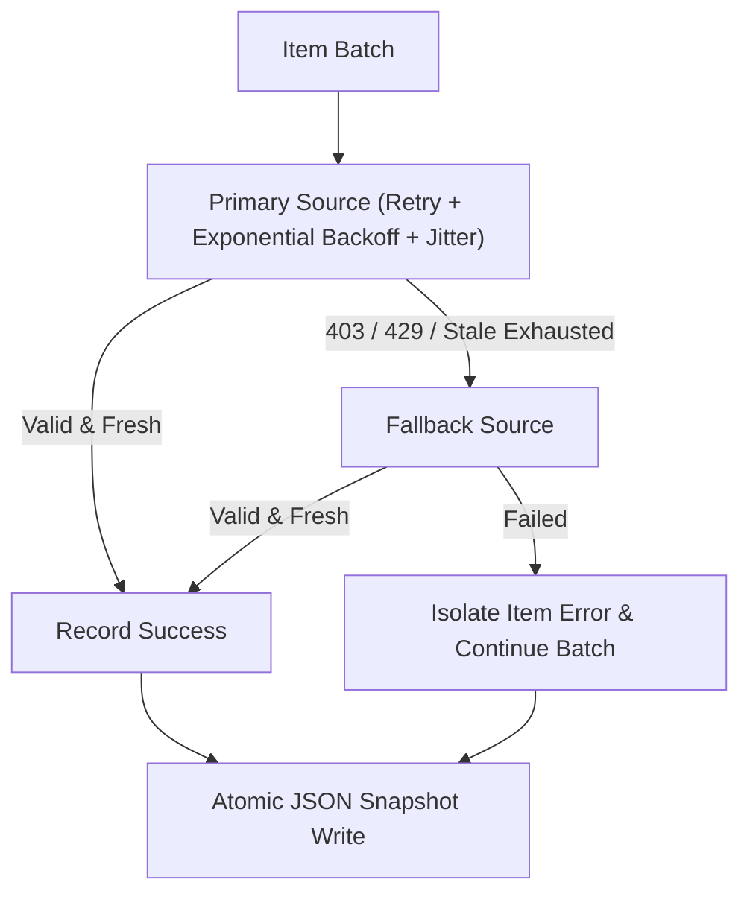

# Resilient API Data Collector (Python)

A zero-dependency Python 3 collector built to handle flaky external APIs reliably—featuring automatic HTTP 403/429/5xx recovery, source fallback failover, freshness SLA checks, per-item fault isolation, and atomic JSON snapshot writes.

## Architecture



## Key Features
- **HTTP 403 / 429 / 5xx Recovery:** Exponential backoff with randomized jitter prevents thundering-herd retries.
- **Primary -> Fallback Failover:** Automatically switches to secondary sources if the primary source stays blocked or returns stale payloads.
- **Freshness SLA Enforcement:** Rejects payloads older than `max_source_age_s` before downstream consumption.
- **Per-Item Fault Isolation:** A single failing item never crashes the batch or blocks healthy items from updating.
- **Atomic JSON Output & Windows Launcher:** Writes snapshots via temp-file + `os.replace` and includes `run_collector.bat` for 1-click Windows execution.

## Quick Start
Run the offline simulation demo:
```bash
python -m collector.cli --output output/snapshot.json
```

Run the unit test suite:
```bash
python -m unittest discover -s tests -v
```
