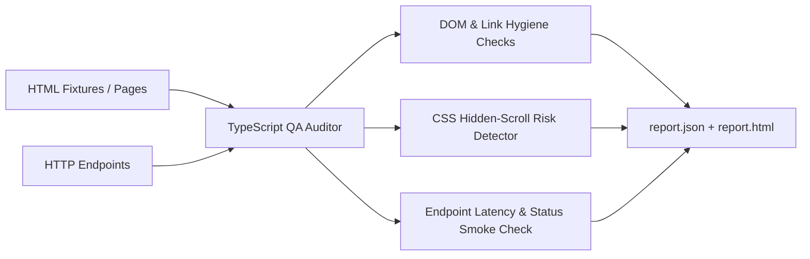

# Web QA & DOM Layout Auditor (TypeScript / Node.js)

A zero-dependency TypeScript QA automation tool that audits HTML pages and API endpoints for accessibility defects, broken link placeholders, duplicate IDs, CSS hidden-scroll content risks, and HTTP smoke regressions—generating both JSON and standalone HTML QA reports.

## Architecture



## Quick Start
Run the demo audit on the sample fixtures:
```bash
node src/cli.ts fixtures/good_page.html fixtures/buggy_page.html --out output
```

Run the automated TypeScript test suite (`node:test`):
```bash
node --test tests/auditor.test.ts
```
